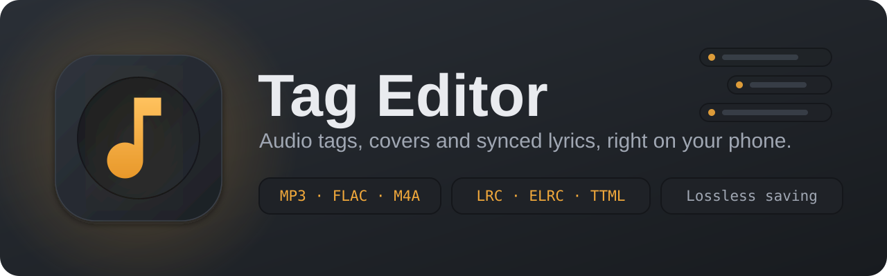
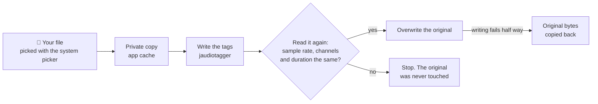
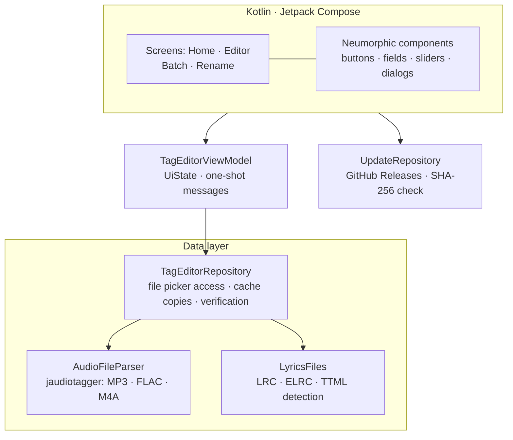
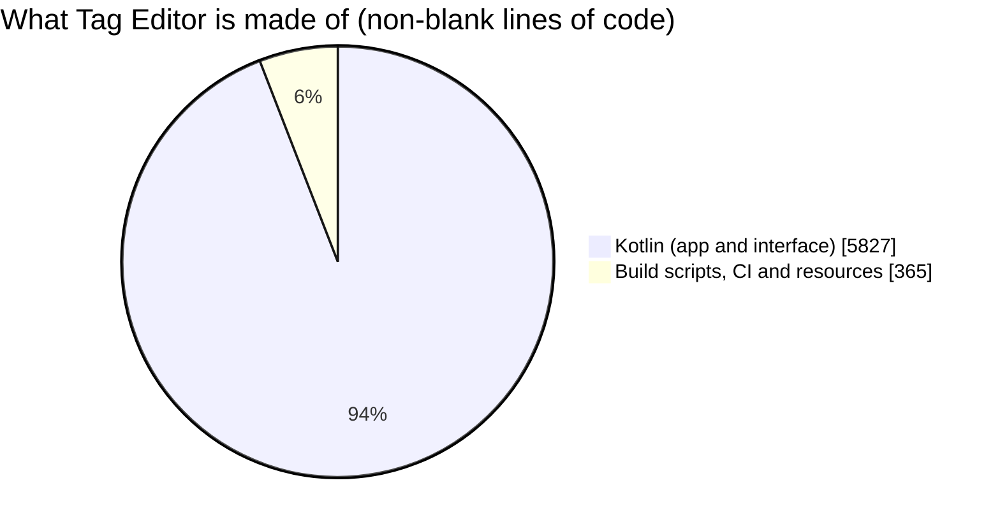

<div align="center">

<br/>


# Tag Editor

### Neumorphic Audio Tag Editor for Android

<p>
  <strong>Clean tags, perfect covers, synced lyrics. Without touching the sound.</strong><br/>
  <em>Edit MP3, FLAC and M4A tags, manage album art, load LRC / ELRC / TTML lyrics and rename files from tags, all on your phone, with lossless and verified saving.</em>
</p>

<br/>

<p align="center">
  <a href="https://github.com/aravindrejidev/TagEditor/releases"></a>
  <a href="https://github.com/aravindrejidev/TagEditor/stargazers"></a>
  <a href="https://github.com/aravindrejidev/TagEditor/releases"></a>
  <a href="https://github.com/aravindrejidev/TagEditor/blob/main/LICENSE"></a>
  <a href="https://github.com/aravindrejidev/TagEditor/commits"></a>
</p>

<p align="center">
  
  
  
  
  
  
</p>
<br/>

[**Features**](#features) · [**Lyrics**](#lyrics) · [**Safe Saving**](#safe-saving) · [**Download**](#download) · [**File Names**](#file-names) · [**Build**](#build) · [**Architecture**](#architecture) · [**Roadmap**](#roadmap) · [**Contributing**](#contributing) · [**Disclaimer**](#disclaimer)

<br/>

</div>

> [!NOTE]
> Tag Editor rewrites the tag block inside your audio files. The audio stream is never decoded or re-encoded, and every save is checked before it replaces your file, but keep a backup of anything you cannot replace. See the [Disclaimer](#disclaimer).

---

<a id="about"></a>
## 🌟 About the Project

**Tag Editor** is a native Android app for people who want their music library to look right: correct titles, artists and albums, a proper cover on every song, track numbers in order, and lyrics that scroll in time. It opens your files through Android's own file picker, edits only the tags and writes them straight back into the original file.

It handles one song in full detail (every field the file stores, cover art and lyrics) or a whole album at once (batch edit, automatic track numbers, one cover for every track, and file names built from tags). Lyrics can be typed or loaded from `.lrc`, `.elrc` and `.ttml` files with their timestamps kept.

No accounts. No ads. No telemetry. Your music is never uploaded; the network is used only to check GitHub for new versions of the app.

<div align="center">
  
</div>

<!--
  SCREENSHOTS: add your images to docs/screenshots/ and remove this comment markup
  to show the gallery. Suggested shots: Home (file list), Editor, Lyrics import,
  Album art, Batch edit, Rename from tags.

<br/>

<div align="center">
  <table>
    <tr>
      <td width="33%" align="center"><br /><sub><b>Home</b></sub></td>
      <td width="33%" align="center"><br /><sub><b>Editor</b></sub></td>
      <td width="33%" align="center"><br /><sub><b>Lyrics import</b></sub></td>
    </tr>
    <tr>
      <td width="33%" align="center"><br /><sub><b>Album art</b></sub></td>
      <td width="33%" align="center"><br /><sub><b>Batch edit</b></sub></td>
      <td width="33%" align="center"><br /><sub><b>Rename from tags</b></sub></td>
    </tr>
  </table>
</div>
-->

---

<a id="features"></a>
## ✨ Features

<div align="center">

<table>
  <tr>
    <td width="50%" valign="top">

#### Single-File Editor
- **Everything the file stores** — title, artist, album, album artist, year, genre, track, disc, BPM, key, language, composer, lyricist, encoder, comment and lyrics, pre-filled and editable.
- **Track and disc as `3` or `3/12`** — the number and the total are stored separately, as the formats expect.
- **Genre picker** — 80+ common genres (including Malayalam, Carnatic, Devotional, Ghazal and Qawwali). Free text still works.
- **Audio facts at a glance** — format, sample rate, bit depth, channels, bit rate (with VBR), duration and file size, plus the full path of the file.
- **Only your changes are written** — untouched fields are left exactly as they were. Clearing a field removes that tag.
- **Revert and discard guard** — undo everything with one tap, and Tag Editor asks before you leave with unsaved edits.
- **Rename on save** — optionally name the file after the title, or rename it from any tag template later.

#### Lyrics
- **Type them or import them** — load `.lrc`, `.elrc`, `.ttml` (also `.xml`, `.dfxp` and `.txt`) files with one tap.
- **Timestamps stay intact** — the file content goes into the tag exactly as written.
- **Format badge** — the editor tells you whether the lyrics are plain text, LRC, enhanced LRC or TTML, and how many lines they have.
- **Any text encoding** — UTF-8, UTF-16 and old Windows-1252 files are read correctly, so Malayalam and other scripts come through.

#### Album Art Manager
- **See what is embedded** — with its format, pixel size and file size.
- **Replace from the gallery** — resize to a largest side of 300 to 2000 px, or embed the original picture untouched.
- **Save it, remove it, undo it** — export the cover as an image file, delete it, or step back before saving.

    </td>
    <td width="50%" valign="top">

#### Batch Editing
- **Pick files or a whole album folder** — sub-folders are scanned too, and a folder scan is sorted naturally (Track 2 comes before Track 10).
- **Write once, apply to all** — album, album artist, artist, year, genre, disc, composer, comment and cover.
- **See what differs** — fields show the value all songs share, or a few of the different values found.
- **Automatic track numbers** — writes `1/12`, `2/12` … in the order of your list.
- **Only ticked fields are written** — a ticked empty field clears that tag on every song.
- **One song selected?** — you get the full editor instead.

#### Tag to File Name
- **Templates** such as `%track% - %artist% - %title%`, with a live preview of every new name before anything is renamed.
- **Safe names** — forbidden characters are removed, tracks are zero-padded, duplicates get `(2)`, and over-long names are trimmed on a character boundary.
- **Remembered** — your last template is saved.

#### Lossless and Safe
- **Tags only** — the audio stream is never decoded or re-encoded.
- **Edit a copy, verify, then replace** — and restore the original bytes automatically if writing fails half way.
- **No storage permission** — files come through Android's Storage Access Framework, which also works with scoped storage on Android 10+.

#### Interface
- **Dark neumorphic design** — raised cards, pressed-in fields and a warm amber accent, drawn with custom components.
- **Tactile** — springy buttons with soft haptic ticks, glowing focus rings, staggered entrances and skeleton loaders.
- **Built for phones and tablets** — edge-to-edge layout with a comfortable maximum width.

#### Updates
- **In-app updater** — tap the version chip on Home to look for a new release. Updates are checked, downloaded and verified inside the app.

    </td>
  </tr>
</table>

</div>

### Supported formats

| Format | Extensions | Tag standard | Notes |
|---|---|---|---|
| **MP3** | `.mp3` | ID3v2 (and ID3v1) | Old ID3v2.2 tags are upgraded to a modern version. A pre-existing ID3v1 tag is kept in sync, and a file with only ID3v1 gets a full ID3v2 tag with the old values carried over. |
| **FLAC** | `.flac` | Vorbis comments | Cover is stored as a standard FLAC picture block. |
| **M4A / MP4** | `.m4a` `.m4b` `.mp4` | MP4 atoms | AAC and ALAC audio in an MP4 container. |

---

<a id="lyrics"></a>
## 🎤 Lyrics: Plain, LRC, ELRC and TTML

Open a song, scroll to **Lyrics** and tap **Import lyrics file**. The text appears in the lyrics box (nothing is written until you tap **Save**), and a badge shows what was recognised.

| Format | Typical file | How it is recognised |
|---|---|---|
| **Plain text** | `.txt` | No timestamps. |
| **LRC** | `.lrc` | Lines that start with `[mm:ss.xx]`. |
| **Enhanced LRC (ELRC)** | `.elrc`, `.lrc` | LRC lines that also carry word timings such as `<mm:ss.xx>`. |
| **TTML** | `.ttml`, `.xml`, `.dfxp` | An XML document with a `<tt>` root and `<p>` lines. |

```text
[ar:Artist]
[ti:Song title]
[00:12.00]First line of the song
[00:17.50]Second line of the song
```

```text
[00:12.00]<00:12.00>First <00:12.60>line <00:13.10>of <00:13.40>the <00:13.80>song
```

**Good to know**

- Files up to **2 MB** are accepted. An empty file, or an XML file that is not TTML, is rejected with a clear message.
- The content is stored **as it is**, apart from normalising line breaks. Tag Editor does not convert between formats.
- Lyrics go into the normal lyrics field of each format: ID3 `USLT` in MP3, `LYRICS` in FLAC and `©lyr` in M4A.

> [!TIP]
> A player shows synced lyrics only if it can read them from that field. Many players understand LRC text there, fewer understand enhanced LRC, and TTML support is rare. Test one song in your player before you update a whole album.

---

<a id="safe-saving"></a>
## 🛡️ How Saving Stays Safe

No storage permission is used. Files come from the Storage Access Framework (`ACTION_OPEN_DOCUMENT` and `ACTION_OPEN_DOCUMENT_TREE`). Because the tag library needs a real file, every save goes through a private working copy:



| Step | What happens |
|---|---|
| **1. Copy** | The document is copied to the app's private cache (jaudiotagger needs a real file), and a second copy is kept as a backup. |
| **2. Write** | Only the changed tags and cover are written to the working copy. |
| **3. Verify** | The working copy is read again. Its sample rate, channel layout and duration (within one second) must match the original, otherwise nothing is written. |
| **4. Replace** | The original document is overwritten. If that fails, the untouched original bytes are copied back automatically. |

---

<a id="download"></a>
## 📥 Download & Installation

<div align="center">

<a href="https://github.com/aravindrejidev/TagEditor/releases/latest" target="_blank" rel="noopener noreferrer"></a>
<a href="https://apps.obtainium.imranr.dev/redirect?r=obtainium://add/https://github.com/aravindrejidev/TagEditor" target="_blank" rel="noopener noreferrer"></a>

Grab `TagEditor-<version>.apk` from the [Releases](https://github.com/aravindrejidev/TagEditor/releases) page. Android 7.0 (API 24) or newer is required.

</div>

### Installing

1. Enable **Install unknown apps** for the app you use to open the APK (browser or file manager).
2. Open the downloaded APK and confirm the installation.
3. Later versions can be installed from inside the app (see [Updates](#updates)), or with Obtainium.

### Getting Started

1. Open Tag Editor and tap **Open files** to pick songs, or **Open folder** to load a whole album.
2. Tap a song to edit it, change what you need and press **Save**.
3. Tick several songs to **batch edit** them, or press **Rename** to name the files from their tags.
4. Open **Lyrics → Import lyrics file** to add synced lyrics, and use **Album art** to replace or export the cover.

> [!TIP]
> Android 11 and newer do not let apps pick the root of internal storage or the `Download` folder itself. Choose the album sub-folder (for example `Music/My Album`) with **Open folder**.

<a id="updates"></a>
### Updates

Tap the version chip on the Home screen to check for a new release. Tag Editor reads the latest release from GitHub, shows the release notes and downloads the APK. Before it hands the file to Android's installer it checks that the download is complete, that its SHA-256 checksum matches the one GitHub publishes for the file (when GitHub provides it), and that the package belongs to Tag Editor. You can choose **Later** or **Skip this version**. Updates install over the old version because every release is signed with the same key.

### Permissions

| Permission | Why |
|---|---|
| *None for storage* | Audio files are opened with the system file picker, so no storage permission is requested. |
| `INTERNET` | Only to check GitHub for new releases and download an update you chose to install. |
| `REQUEST_INSTALL_PACKAGES` | So Android can install the downloaded update. |

---

<a id="file-names"></a>
## 🏷️ Tag to File Name

Press **Rename** on the file list, or **Rename file from tags** in the editor. The preview shows every old and new name before anything changes.

| Placeholder | Becomes |
|---|---|
| `%track%` | Track number, padded to two digits (`3` → `03`) |
| `%title%` `%artist%` `%album%` | The matching tag |
| `%albumartist%` | Album artist (falls back to the artist) |
| `%year%` | Four-digit year |
| `%genre%` `%composer%` | The matching tag |
| `%disc%` | Disc number without the total |
| `%filename%` | The current file name without its extension |

The default template is `%track% - %artist% - %title%`. For example, `03 - Artist - Song.flac`.

> [!NOTE]
> Renaming uses `DocumentsContract.renameDocument`. Some cloud storage providers do not support it and will report an error for those files. The audio and tags are never touched by a rename.

---

<a id="build"></a>
## 🛠️ Build from Source

**You need**

- **JDK 17**
- **Gradle 8.9**
- **Android SDK** with platform 35

```bash
git clone https://github.com/aravindrejidev/TagEditor.git
cd TagEditor

# Build a debug APK
gradle :app:assembleDebug
# Built APK will be located at: app/build/outputs/apk/debug/
```

> [!TIP]
> The repository does not contain the Gradle wrapper. Run `gradle wrapper --gradle-version 8.9` once if you want a `gradlew`, or just open the project in a recent Android Studio.

### GitHub Actions: no computer needed

| Workflow | Trigger | Result |
|---|---|---|
| **Release APK** | Run manually: **Actions → Release APK → Run workflow**, then type the new version (for example `1.2.0`) | Builds a signed release APK, publishes a GitHub release named `v1.2.0` and attaches `TagEditor-1.2.0.apk` |

**Release notes.** The text of [`release-message.md`](release-message.md) becomes the release description, so edit it before each release.

**Signing.** Add a repository secret named `SIGNING_PASSPHRASE` (**Settings → Secrets and variables → Actions**). The first release creates a signing key and stores it, encrypted with that passphrase, in `keystore/release.p12.enc`. Later releases reuse it, which is what lets updates install over older versions. Keep the passphrase safe, because a new key cannot update apps signed with the old one.

**Versions.** Each version must be higher than the last release. The version code is derived from it (`1.2.0` becomes `10200`).

---

<a id="architecture"></a>
## 🏗️ Architecture & Tech Stack

Tag Editor is a single-module Kotlin app. A `ViewModel` holds the UI state, a repository talks to storage, and jaudiotagger does the tag work.



| Folder | What it does |
|---|---|
| `data/` | `AudioFileParser` (reads and writes tags), `TagEditorRepository` (picker access, private copies, verified save, rename), `LyricsFile` (lyrics decoding and format detection), `FileNameTemplate`, `ImageTools`, `Genres` and the models |
| `viewmodel/` | `TagEditorViewModel` and the `UiState` classes for the editor, batch and rename screens |
| `ui/screens/` | `HomeScreen`, `EditorScreen`, `BatchScreen`, `RenameScreen` and `CoverArtPicker` |
| `ui/components/` | The neumorphic building blocks, dialogs, file pickers and the lyrics import row |
| `ui/theme/` | Colours, type, shapes, motion, icons and the soft-shadow drawing code |
| `update/` | The in-app updater: release lookup, download, checksum and installer hand-off |
| `.github/workflows/` | The release workflow |
| `keystore/` | The encrypted signing key used by the release workflow |

### Design rules

These keep your files safe, and any change should respect them:

- **Nothing is written without being verified.** Edit a private copy, check the audio stream, then replace the original, with automatic restore on failure.
- **One file job at a time.** jaudiotagger keeps global options, so the repository serialises tag reading and writing behind a single lock.
- **Only changes are written.** Fields are compared with the original values, and untouched tags are left alone.
- **No broad storage access.** Every file comes through the system picker, so Tag Editor sees only what you choose.

### Tech stack

| Component | Version |
|---|---|
| Kotlin | 2.0.21 |
| Android Gradle Plugin | 8.7.3 |
| Gradle | 8.9 |
| Jetpack Compose BOM / Material 3 | 2024.12.01 |
| jaudiotagger | 3.0.1 |
| Kotlin coroutines | 1.9.0 |
| Core library desugaring (NIO) | 2.1.5 |
| Java | 17 |
| Android | min SDK 24 · target and compile SDK 35 |

**Built with:** Kotlin · Jetpack Compose · Material 3 · jaudiotagger · Coroutines · GitHub Actions

---

<a id="roadmap"></a>
## 🗺️ Project Status & Roadmap

<p align="center">
  <a href="https://github.com/aravindrejidev/TagEditor/commits"></a>
  <a href="https://github.com/aravindrejidev/TagEditor/graphs/commit-activity"></a>
  <a href="https://github.com/aravindrejidev/TagEditor"></a>
  <a href="https://github.com/aravindrejidev/TagEditor"></a>
  <a href="https://github.com/aravindrejidev/TagEditor/issues"></a>
</p>

<div align="center">



</div>

**Done**
- [x] Single-file editor with 16 fields, audio facts and a genre picker
- [x] MP3 (ID3v1 / ID3v2), FLAC (Vorbis comments) and M4A / MP4 support
- [x] Album art manager: replace, resize, export, remove and undo
- [x] Batch editing with automatic track numbers and a shared cover
- [x] Tag to file name templates with a live preview
- [x] Lyrics import from LRC, ELRC and TTML files, with format detection
- [x] Verified, lossless saving with automatic restore
- [x] In-app updater with checksum verification, and a one-click release workflow

**Ideas**
- [ ] Write MP3 lyrics also as an ID3 synced-lyrics (`SYLT`) frame, for players that read only that frame
- [ ] Convert TTML and ELRC lyrics to plain LRC on import
- [ ] Lyrics in batch editing
- [ ] Search and sorting in the file list

Have an idea? Open an [issue](https://github.com/aravindrejidev/TagEditor/issues) and tell us.

### 📈 Star History

<p align="center">
  <a href="https://star-history.com/#aravindrejidev/TagEditor&Date">
    
  </a>
</p>

---

<a id="support"></a>
## ☕ Support the Project

Tag Editor is free and open source, with no ads or subscriptions. If it tidied up your library, you can support it by:

- ⭐ **Starring** the repository
- 📣 **Sharing** it with friends who care about their music collection
- 🐛 **Reporting** bugs and odd behaviour on the [issues page](https://github.com/aravindrejidev/TagEditor/issues)

<!-- Add your donation links here, for example Ko-fi or PayPal -->

---

<a id="contributing"></a>
## 💡 Contributing

Contributions are welcome, whether it's a bug fix, a new feature, or better wording.

- **Something not working?** Open an [issue](https://github.com/aravindrejidev/TagEditor/issues) with your phone model, Android version, the file format (MP3, FLAC or M4A), where the file lives (internal storage, SD card or cloud provider) and what you expected. For a lyrics problem, mention the file type and the player you use.
- **Bigger changes:** open an issue first so we can talk it through.
- **Pull requests** should build cleanly (`gradle :app:assembleDebug`), follow the official Kotlin code style, and keep to the [design rules](#design-rules): verify before replacing, one file job at a time, and no broad storage access.

### 👥 Contributors

<div align="center">
  <a href="https://github.com/aravindrejidev/TagEditor/graphs/contributors">
    
  </a>
</div>

---

## 🎧 More from the Same Author

| Project | What it is |
|---|---|
| [**Resonix**](https://github.com/aravindrejidev/Resonix) | Bit-perfect music player for Android, with a native C++ engine, USB DAC output and a neumorphic interface |
| [**Resonix TV**](https://github.com/aravindrejidev/Resonix-TV) | Home-cinema audio player for Android TV, with a per-channel mixer, graphic and parametric EQ, and FFmpeg decoders for DTS, TrueHD and E-AC3 |
| [**Spectra**](https://github.com/aravindrejidev/Spectra) | Audio forensics analyzer for Android: spectrogram, fake-lossless detection, LUFS, true peak and dynamic range |

---

<a id="acknowledgments"></a>
## 🤝 Acknowledgments

- **[jaudiotagger](https://www.jthink.net/jaudiotagger/)** — the library that reads and writes MP3, FLAC and M4A tags.
- **[LRC](https://en.wikipedia.org/wiki/LRC_(file_format))** and **[TTML](https://www.w3.org/TR/ttml2/)** — the lyrics formats Tag Editor can import.
- **Jetpack Compose**, **Material 3** and **Kotlin coroutines** — the foundations of the interface and the background work.

---

<a id="disclaimer"></a>
## ⚖️ License & Disclaimer

### License
See the [LICENSE](LICENSE) file for details. Tag Editor uses jaudiotagger, which is distributed under the LGPL 2.1. AndroidX, Jetpack Compose, Material 3 and Kotlin coroutines are distributed under the Apache License 2.0.

### Disclaimer
- **Back up what matters.** Saving rewrites the tags inside your file. Every save is verified and rolled back on failure, but a phone that loses power or a storage provider that misbehaves can still cause damage. Keep a copy of irreplaceable files.
- **Lyrics are stored as text.** Imported LRC, ELRC and TTML content is written unchanged into the lyrics field. Whether a player shows it synced depends on the player, and Tag Editor does not write the separate ID3 synced-lyrics (`SYLT`) frame.
- **Providers differ.** Some cloud or network storage providers cannot overwrite or rename files in place. Tag Editor reports the error and keeps the original file.
- **Supported formats only.** MP3, FLAC and M4A / MP4 files. Other formats are skipped.
- **Privacy.** Everything happens on the device. Tag Editor has no accounts and no telemetry, and it does not upload your music. The only network use is checking GitHub for app updates.

---

<div align="center">
  Built with care, one tag at a time. Happy listening! 🎧
</div>
